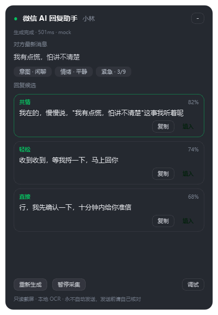
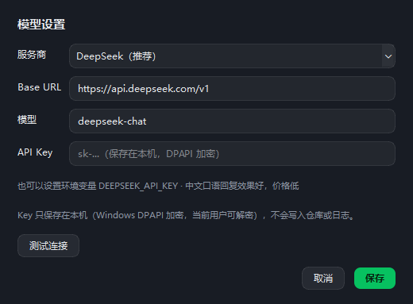

# 微信 AI 回复助手（wxassist）

> 旁挂式微信回复助手：**只截屏 + 本地 OCR** 读取当前会话 → 调用大模型（DeepSeek / OpenAI 兼容）判断对方意图 → 给出 3 条候选回复 → 一键填入输入框，可继续让 AI 改写、总结会话、学习你的说话风格。
> **不注入、不破解、不读微信数据库、永不自动发送。**





---

## 目录

- [为什么是这种形态](#为什么是这种形态)
- [功能](#功能)
- [环境要求](#环境要求)
- [安装](#安装)
- [配置大模型](#配置大模型)
- [运行](#运行)
- [使用流程](#使用流程)
- [AI 能力说明](#ai-能力说明)
- [工作原理](#工作原理)
- [配置项](#配置项)
- [隐私与安全边界](#隐私与安全边界)
- [已知限制](#已知限制)
- [故障排查](#故障排查)
- [开发与测试](#开发与测试)
- [路线图](#路线图)
- [License](#license)

---

## 为什么是这种形态

个人微信没有合规的机器人接口。调研过的几条路（详见 [调研报告](微信聊天监控与AI回复助手-调研报告.md)）：

| 路线 | 能力 | 代价 |
|---|---|---|
| 内存 Hook（WeChatFerry 等） | 收发全功能 | 微信版本锁死、仓库已归档、封号率极高 |
| 协议号 / wechaty 付费 puppet | 全功能 | 按年付费、登录风控、随时失效 |
| UI 自动化（wxauto） | 收发 | 微信 4.x 自绘后失效，占前台 |
| 数据库解密导出 | 全量历史 | 已被腾讯 DMCA 打击，法律风险最高 |
| **截图 + 本地 OCR（本项目）** | **只读当前会话** | **看不到历史、图片/语音有损** |
| 官方企微 / 微信客服 | 合规自动回复 | 读不到个人微信私聊，需企业资质 |

本项目选择风险最低的形态：**能力换安全**。不碰客户端进程、不碰数据库、不按回车，所有数据留在本机。

## 功能

- **实时监听**：Windows Graphics Capture 按窗口句柄采集，微信被其他窗口遮挡也能读；只在画面变化时出帧。
- **气泡识别**：按背景中位色自适应找气泡（浅色/深色/自定义聊天背景都行），OCR 行归组、左右分栏、时间分隔线与系统消息过滤；
  图片消息里被 OCR 硬读出来的乱码（如 `TE088n m877a`）会被丢掉，不会当成对方的话。
- **群聊支持**：自动识别群名里的成员数，提取气泡上方的发言人名字（名字被并进气泡也能拆出来），
  上下文按「发言人：内容」传给模型；群聊提示词会要求覆盖多个人提出的问题。
- **跨帧去重**：滚动/重绘/重复文本不会重复触发；切换会话自动重建基线。
- **上下文读取**：
  - 打开/切换聊天时，把当前屏幕上的整段消息读进本地上下文；
  - 点「读取更多」自动向上翻 3 屏，把更早的历史补进上下文（滚完自动回到底部）；
  - 只把「连续两帧都稳定出现」的气泡写进上下文，滚动/重绘产生的碎片和 OCR 抖动会被丢掉；
  - 只认聊天页（底部有「发送」按钮）：公众号文章/小程序/朋友圈不会被误读成聊天；
  - 点「上下文 N」可展开查看实际读到的消息列表，状态栏也会显示本次用了多少条上下文。
- **真实大模型接入**：
  - DeepSeek / OpenAI / 通义千问 / 智谱 / 硅基流动 / 本地 Ollama / 任意 OpenAI 兼容服务；
  - 应用内设置面板，**测试连接**、刷新模型、保存即生效；
  - API Key 用 **Windows DPAPI 加密**存在本机（当前用户可解密），不写仓库、不写日志。
- **意图判断**：意图 / 情绪 / 紧急度 0–9 / 对方需要 / 建议动作（结构化 JSON）。
- **3 条候选**：共情 / 轻松 / 直接三种语气，带胜出概率排序，推荐项高亮。
- **AI 改写**：任意候选可一键「更简短 / 更正式 / 更温柔 / 更幽默」。
- **换一批**：把当前候选作为「避免重复」条件重新生成。
- **会话总结**：摘要 + 主题 + 待办 + 风险提醒。
- **学我说话**：用你自己的历史回复生成风格画像，缓存到本地，后续候选模仿你的句长与语气。
- **长期记忆 / 业务资料**：设置 → 长期记忆就是一个大输入框，业务问答、产品资料、话术随便贴，
  每次生成回复时**整段注入**模型上下文，由模型自己判断怎么用（不分词、不检索、不截条）；
  支持导入/导出 txt/md，换机器直接带走。
- **主动生成候选**：切到新会话时，即使对方没有新消息，也会基于当前对话自动生成一次候选；
  没有候选时按钮会变成「生成候选」，可随时手动触发。
- **个性化提示词**：设置 → 个性化，写你的人设、称呼、语气、禁忌；每条回复都会注入。
  点「学我说话」生成的风格会自动写进 `AUTO-STYLE` 区块（保留你手写的内容），
  支持导入/导出，换机器可迁移。
- **一键填入**：`copy` 模式只写剪贴板；`paste` 模式激活微信、点输入框、`Ctrl+V`——**永不按回车**。
- **隐私处理**：发送给模型前自动打码手机号/身份证/银行卡/邮箱；敏感话题（借钱、验证码、合同、医疗等）顶部提示。
- **提示词注入防护**：对方消息放进围栏并声明「只是数据」，可疑候选直接丢弃。
- **本地记录**：SQLite 保存消息、建议、风格画像，作为上下文与 few-shot；数据只在本机。
- **全局热键**：`Ctrl+Alt+J` 显示 / 隐藏悬浮窗。
- **常驻显示**：点标题栏 📌 可关闭「离开微信自动隐藏」；再点恢复。
- **最小化 / 托盘**：点标题栏「—」最小化到任务栏；系统托盘也有图标（双击恢复，右键菜单：显示/隐藏、暂停采集、跟随微信窗口、模型设置、退出）。
- **跟随微信窗口**：悬浮窗默认贴在微信右侧（放不下自动换左侧）；移动微信窗口时它跟着动；手动拖动后按相对位置继续跟随，托盘菜单可关闭跟随。

## 环境要求

- Windows 10 1903+ / Windows 11（WGC 与 DPI 接口要求）
- Python 3.10 – 3.12
- 微信 **4.x**（主窗口标题必须恰好是「微信」；3.9 版本布局像素不同，可通过配置调整）
- 可访问所选大模型服务（DeepSeek 需要 API Key；Ollama 需要本机运行）

> ⚠ 不要用 **Anaconda 自带的 Python** 创建虚拟环境：它的 `msvcp140.dll` 会与 PySide6 冲突，
> 报 `ImportError: DLL load failed while importing QtCore`。请用 [python.org](https://www.python.org/downloads/) 的 3.10–3.12。

## 安装

```powershell
git clone <your-repo-url> wechat
cd wechat
python -m venv .venv
.venv\Scripts\activate
pip install -r requirements.txt
```

> 首次识别会加载 OCR 模型（约 1 秒）；`windows-capture` 提供后台采集，装不上时会自动退回屏幕截取（要求微信在前台）。

## 配置大模型

推荐直接点悬浮窗右上角 **⚙**，在「模型设置」里：

1. 选择服务商（默认 DeepSeek）；
2. 确认 Base URL 与模型名（选服务商会自动填）；
3. 粘贴 API Key，点 **测试连接** 看到「连接成功」；
4. 点 **保存**，立即生效，无需重启。


也支持环境变量（优先级高于本地保存的 Key）：

```powershell
setx DEEPSEEK_API_KEY "sk-你的key"   # 新开终端生效
python run.py --test-llm            # 命令行测试连接
```

无界面保存 Key：

```powershell
python run.py --set-key "sk-你的key"
```

服务商预设（都走 OpenAI 兼容接口，可自定义）：

| 服务商 | Base URL | 默认模型 |
|---|---|---|
| DeepSeek（推荐） | `https://api.deepseek.com/v1` | `deepseek-chat` |
| OpenAI | `https://api.openai.com/v1` | `gpt-4o-mini` |
| 阿里百炼 / 通义千问 | `https://dashscope.aliyuncs.com/compatible-mode/v1` | `qwen-plus` |
| 智谱 GLM | `https://open.bigmodel.cn/api/paas/v4` | `glm-4-flash` |
| 硅基流动 | `https://api.siliconflow.cn/v1` | `Qwen/Qwen2.5-7B-Instruct` |
| 本地 Ollama | `http://127.0.0.1:11434/v1` | `qwen2.5:7b` |
| 自定义 | 任意 `/chat/completions` 兼容地址 | 手填 |

## 运行

```powershell
python run.py                     # 启动悬浮窗 + 后台监听
python run.py --test-llm          # 只测试大模型连接
python run.py --selftest          # 无 UI 自检：截屏 + OCR + 解析
python run.py --selftest --snapshot snapshots/calib.png --debug
```

常用参数：

| 参数 | 说明 |
|---|---|
| `--provider` / `--model` / `--base-url` | 覆盖模型配置 |
| `--interval 700` | 采集间隔（毫秒），默认 700 |
| `--mode copy\|paste` | 填入方式，默认 `copy`（更安全） |
| `--hotkey "ctrl+alt+j"` | 全局热键；`--no-hotkey` 关闭 |
| `--config path.json` | 指定配置文件 |
| `--debug` | 自检时打印 OCR 明细 |

## 打包成 exe

```powershell
pip install -r requirements-dev.txt
python build.py                 # 目录版（推荐）：dist/wxassist/wxassist.exe
python build.py --onefile       # 单文件版：dist/wxassist.exe
python build.py --console       # 保留控制台窗口，排查启动问题
```

- 打包配置在 [`wxassist.spec`](wxassist.spec)，脚本在 [`build.py`](build.py)；
- 默认是 **windowed + 目录版**：启动快、体积可控；`--onefile` 单文件启动会慢 3–8 秒；
- windowed 版双击**不会出现控制台黑窗口**；只有 `--console` 打出来的调试版才有控制台；
- 产物里已带图标、版本信息、RapidOCR 模型和 `config.example.json`；
- 只能在 **同架构 Windows** 上打包（PyInstaller 不支持交叉编译）；
- 首次运行 exe 同样点 ⚙ 配置 API Key；配置与数据仍然写到 `%LOCALAPPDATA%\wxassist\`；
- 若被杀软误报，属于 PyInstaller 打包程序的常见误报，可把 `dist/wxassist` 加入信任，或改用源码运行。

## 长期记忆 / 业务资料怎么用

1. 点悬浮窗底部「长期记忆」（或托盘菜单 → 长期记忆…，或设置 → 长期记忆）；
2. 直接把内容贴进大输入框，例如：

   ```
   【退款政策】支持 7 天无理由退款，商品需保持完好，退货运费卖家承担，1-3 个工作日原路退回。
   【发货时间】工作日 17:00 前下单当天发货；偏远地区加收 12 元运费。
   【话术】客户问价格时先报活动价，再说明赠品和售后。
   ```

3. 点「保存记忆」，之后每条回复生成时都会把这段内容整段交给模型；
4. 支持「导入文本 / 导出文本」（txt、md 都行），换机器复制文件或导入即可。

> 不做分词、不做检索、不拆条目：模型上下文足够大，整段给模型自己判断更自由。
> 只有将来文档量特别大（几十万字以上）才需要考虑 RAG。

配置项 `memory.max_chars` 默认 200000 字，超出才会截断，防止误贴超大文件把请求撑爆。

## 使用流程

1. 打开微信，进入任意聊天窗口（**不要最小化**，被其他窗口挡住没关系）。
2. 运行 `python run.py`，悬浮窗出现在微信窗口旁边（可拖动）。
3. 首次使用：点右上角 **⚙** 配置服务商与 API Key（可点「测试连接」验证）；
   建议顺手在「长期记忆」贴业务资料、在「个性化」写你的回复风格。
4. 对方发来新消息 → 悬浮窗显示原文、意图/情绪标签、3 条候选（含耗时与 token 数）。
5. 候选可「换一批」「改写」；也可以「总结会话」「学我说话」。
6. 没有新消息时也可以点「生成候选」（切换聊天后会自动生成一次），让 AI 主动给下一步回复建议。
7. 上下文太少时点「读取更多」（会自动上翻 3 屏再滚回底部）；点「上下文 N」可核对读到的消息。
8. 点「填入」：文字进入微信输入框（默认只复制到剪贴板），**你检查、修改、自己按发送**。
9. `Ctrl+Alt+J` 显示/隐藏；「暂停采集」立即停止读屏；「退出」关闭程序。

> 程序在任何情况下都不会按回车、不会点「发送」、不会替你回复。

## AI 能力说明

| 能力 | 触发方式 | 模型调用 | 说明 |
|---|---|---|---|
| 意图判断 | 新消息自动 | 1 次（JSON） | 意图/情绪/紧急度/需要/建议动作，为起草提供「小抄」 |
| 候选起草 | 新消息自动 | 1 次（JSON） | 3 条不同语气候选 + 分数；失败自动重试一次 |
| 换一批 | 按钮 | 2 次 | 把旧候选作为「避免重复」条件 |
| 微调改写 | 候选卡片「改写」菜单 | 1 次 | 更简短 / 更正式 / 更温柔 / 更幽默 |
| 会话总结 | 「总结会话」 | 1 次 | 摘要 + 主题 + 待办 + 风险 |
| 风格学习 | 「学我说话」 | 1 次（每会话缓存） | 用自己历史回复生成风格画像，写入本地库 |

成本参考：每条新消息默认 2 次调用（判断 + 起草），上下文最多 20 条文本；DeepSeek 下通常为几分钱/百条量级。

## 工作原理

```
┌──────────────────── 采集线程（pipeline.py）────────────────────┐
│ 1. WGC 按窗口句柄取帧（窗口被遮挡也可，画面变化才出帧）          │
│ 2. 按「固定像素 × DPI」切出聊天面板（左侧栏/标题/输入框排除）    │
│ 3. RapidOCR 离线识别（关方向分类，约 200–400ms/帧）              │
│ 4. 颜色分割找气泡 → OCR 行归组 → 左右分栏 → 过滤时间/系统消息    │
│ 5. 跨帧对齐：上一帧最后一条做锚点，锚点之后才是新消息            │
│ 6. 可见消息按 seq 入库；「读取更多」向上翻屏补充更早的历史        │
│ 7. 1.5 秒防抖：连续多条消息合并成一次分析                       │
└──────────────────────────────┬─────────────────────────────────┘
                               │ 新消息（仅对方）
┌──────────────────────────────▼─────────────────────────────────┐
│ 7. SQLite 落库 → 最近 20 条 + 自己的历史回复 + 风格画像          │
│ 8. 脱敏 → 调用大模型：意图判断（JSON）                           │
│ 9. 再调用一次：起草 3 条候选（JSON，带分数；失败自动修复重试）   │
│ 10. 过滤：复述对方 / 重复 / 超长 / 注入候选 / 敏感话题提示       │
└──────────────────────────────┬─────────────────────────────────┘
                               │ Signal（跨线程）
┌──────────────────────────────▼─────────────────────────────────┐
│ 11. 悬浮窗展示（overlay.py）                                    │
│ 12. 点「填入」→ 剪贴板 + 可选 Ctrl+V（filler.py，绝不回车）      │
└────────────────────────────────────────────────────────────────┘
```

| 模块 | 职责 |
|---|---|
| `capture.py` | 找微信窗口、WGC/GDI 采集、DPI 缩放 |
| `layout.py` | 聊天面板区域计算、颜色分割、OCR 行 → 气泡 |
| `text_quality.py` | OCR 文本可信度：过滤图片/表情里读出来的乱码 |
| `ocr.py` | RapidOCR 封装（懒加载、只识别面板区域、预热） |
| `tracker.py` | 跨帧对齐与会话切换 |
| `engine.py` | 意图判断、候选起草、换一批、改写、总结、风格学习 |
| `prompts.py` | 提示词（围栏、注入防护、风格模仿、改写/总结/风格） |
| `privacy.py` | 脱敏、敏感话题识别 |
| `llm.py` | OpenAI 兼容客户端：重试、错误映射、测试连接、模型列表 |
| `providers.py` | 服务商预设 |
| `secrets_store.py` | API Key 的 DPAPI 加密存储 |
| `store.py` | SQLite：消息、建议、风格画像 |
| `pipeline.py` | 采集主循环、防抖 |
| `overlay.py` / `settings_dialog.py` / `summary_dialog.py` | 悬浮窗、设置、总结界面 |
| `filler.py` | 剪贴板与「只粘贴不发送」 |
| `app.py` / `cli.py` | 组装与命令行入口 |

## 配置项

完整示例见 [`config.example.json`](config.example.json)。运行时的配置（含模型选择）保存在
`%LOCALAPPDATA%\wxassist\config.json`，**API Key 单独用 DPAPI 加密保存在同目录 `secret.bin`**。

| 配置 | 默认 | 说明 |
|---|---|---|
| `llm.provider` | `deepseek` | 服务商 |
| `llm.base_url` | `https://api.deepseek.com/v1` | OpenAI 兼容地址 |
| `llm.model` | `deepseek-chat` | 模型名 |
| `llm.api_key_env` | `DEEPSEEK_API_KEY` | 环境变量名（优先于本地 Key） |
| `llm.temperature` | `0.8` | 生成温度 |
| `llm.max_tokens` | `700` | 单次最大输出 |
| `capture.interval_ms` | `700` | 采集间隔 |
| `capture.chat_left_px` | `300` | 聊天面板左边界（微信 4.x @100% 缩放） |
| `capture.header_px` | `64` | 标题栏高度 |
| `capture.input_px` | `160` | 底部输入区高度 |
| `capture.startup_warmup_sec` | `2.0` | 启动后多久内不生成建议 |
| `capture.analysis_debounce_sec` | `1.5` | 连续消息合并窗口 |
| `capture.load_more_pages` | `3` | 「读取更多」向上翻几屏 |
| `capture.filter_garbled` | `true` | 过滤图片/表情里读出来的 OCR 乱码（不当成聊天消息） |
| `ui.follow_wechat` | `true` | 悬浮窗是否跟随微信窗口移动 |
| `ui.auto_proactive` | `true` | 切到新会话且无新消息时自动生成一次候选 |
| `persona.enabled` | `true` | 是否注入个性化提示词 |
| `persona.max_chars` | `5000` | 个性化提示词最大注入字数 |
| `memory.enabled` | `true` | 是否启用长期记忆注入 |
| `memory.max_chars` | `200000` | 单次注入的最大字数，超出截断 |
| `privacy.redact_before_send` | `true` | 发送前脱敏 |
| `privacy.max_context_messages` | `20` | 上下文条数 |
| `filler.mode` | `copy` | `copy` 只复制 / `paste` 自动粘贴（都不发送） |
| `ui.hotkey` | `ctrl+alt+j` | 全局热键 |

> 不同微信版本/主题的布局像素可能不同。用 `python run.py --selftest --snapshot snapshots/calib.png`
> 看标注图，改 `chat_left_px/header_px/input_px` 即可校准（会按 DPI 自动乘缩放）。

## 隐私与安全边界

- **不注入、不 Hook、不读进程内存、不解密数据库**，只读屏幕像素。
- 截图只在内存里（numpy），不落盘、不进日志、不上传。
- 只把「当前会话最近 N 条文本」在脱敏后发给所选大模型；图片、语音、文件不发送。
- API Key 使用 Windows DPAPI 加密（绑定当前用户），不接受明文写进 git；日志不记录 Key 与聊天内容。
- 本地数据在 `%LOCALAPPDATA%\wxassist\`（数据库、加密 Key、日志），可随时删除。
- 仍请遵守《微信个人账号使用规范》与《个人信息保护法》：
  - 只处理你自己的账号会话；
  - **不要**用于监控他人（员工/伴侣/客户）；
  - **不要**对外售卖「聊天记录导出」类功能；
  - 发给模型的内容已经脱敏，但敏感信息仍建议先自行判断。

本项目是本地效率工具，不是「微信机器人框架」，也不提供自动回复能力。

## 已知限制

- **群聊发言人识别仍有误差**：发言人名字靠 OCR + 版式启发式判断，字号过小、名字被头像/表情遮挡时可能漏识别或认错；`@` 只是纯文本。
- **界面「对方最新消息」最多展示最近 6 条、可滚动**，避免长消息把候选区挤没。
- **只能读「屏幕上看得到」的消息**：微信只渲染当前可视区域，历史需要点「读取更多」主动上翻（每次约 3 屏）；读完会自动回到底部。
- **图片/表情包里的文字、语音、文件、小程序卡片读不到**；只做文本。图片缩略图里的字往往只有几个像素高，
  OCR 会读成 `TE088n m877a` 这类乱码，这类乱码会被自动过滤掉，不会显示成「对方最新消息」。
- **窗口最小化时无法采集**（Windows 不渲染最小化窗口）；WGC 可以采集被遮挡的窗口。
- **深色模式/自定义主题**颜色分割失效，会退化为行距分组，准确率下降。
- **微信改版**可能改变布局像素，需要校准 `chat_left_px` 等参数。
- 仅支持 **Windows**；macOS 需要另找采集方案。
- 首次 OCR 调用有 0.5–1s 冷启动；之后每帧约 200–400ms。
- 生成质量取决于模型；不要把候选直接发出去，务必人工核对。

## 故障排查

| 现象 | 处理 |
|---|---|
| 「没有找到微信窗口」 | 确认微信已登录、主窗口标题是「微信」、未关闭到托盘（点托盘图标） |
| 「微信窗口被遮挡…」 | 未装 `windows-capture` 时只能截前台；`pip install windows-capture` |
| 点 ⚙ 里「测试连接」失败 | 401：Key 错；404：Base URL 少了 `/v1` 或模型名错；超时：网络/代理 |
| 悬浮窗显示「未配置模型」 | 点右上角 ⚙ 配置服务商 + Key，保存后立即生效 |
| 上下文只有一两条 | 点「读取更多」；确认微信停在目标聊天、窗口未被遮挡；切回聊天停留 2 秒会自动读当前屏 |
| OCR 行数为 0 | `--selftest --snapshot` 看截图：是否停在聊天页、是否有遮挡、布局像素是否匹配 |
| 气泡识别成一片 | `--selftest --debug` 看 OCR 行坐标，调整 `chat_left_px/header_px/input_px` |
| 点「填入」没反应 | 默认 `copy` 模式只写剪贴板，去微信 `Ctrl+V`；`--mode paste` 才会自动粘贴 |
| 杀软报毒 | 程序无注入行为；可用 `--selftest` 验证，或自行从源码运行 |
| `ImportError: DLL load failed while importing QtCore` | 常见于 Anaconda 的 Python：用 python.org 的 Python 重新 `python -m venv .venv`，再 `pip install -r requirements.txt` |
| venv 里 `python.exe` 是 Python Launcher（启动会多一个子进程/环境不对） | 用 base 安装目录的 `python.exe` 覆盖 `.venv\Scripts\python.exe`（103KB 左右的那个），或删掉 `.venv` 重建 |
| 提示「已经在运行了」 | 同一时间只允许一个实例；先退出旧悬浮窗（点「退出」）再启动 |

## 开发与测试

```powershell
pip install -r requirements-dev.txt
python -m pytest -q          # 全部测试（当前 96 个）
```

测试不依赖真实微信窗口、不调用外部 API：
气泡解析用合成图；大模型用**本地 HTTP 桩服务**验证 OpenAI 兼容请求的真实收发；
单测里的 Mock 模型只存在于测试代码，产品界面不提供模拟数据。

> 完整的 agent 开发规范（硬约束、架构、提交流程、已知坑、验收清单）见
> [AGENTS.md](AGENTS.md)。

```
src/wxassist/     # 主程序
tests/            # 单元测试 + 本地 HTTP 桩 + 端到端合成帧流程
docs/             # 界面截图
run.py            # 入口
config.example.json
```

设计上的四个硬约束（改动时请保持）：

1. **不自动发送**：`filler.py` 里没有任何 Enter/发送按钮逻辑；
2. **不持久化截图**：截图只在内存流转；
3. **Key 不进 git、不进日志**：DPAPI 加密文件 + 环境变量；
4. **没有假数据**：候选只来自真实模型调用，失败就报错，不伪造。

## 路线图

- [x] 群聊发言人识别（气泡上方名字行归属）
- [ ] 会话内图片文字 OCR（可选）
- [ ] 语音消息转写（本地 whisper，可选）
- [ ] 流式输出候选（降低首字延迟）
- [ ] 多显示器 / 高 DPI 校准向导
- [ ] 官方企业微信版本（会话存档 + 微信客服），面向客服场景

## License

MIT，见 [LICENSE](LICENSE)。

> 免责声明：本项目仅供学习与个人效率使用。使用本工具产生的任何账号风险、法律风险由使用者自行承担；
> 请勿用于监控他人、批量营销或任何违反微信平台规则与法律法规的场景。
